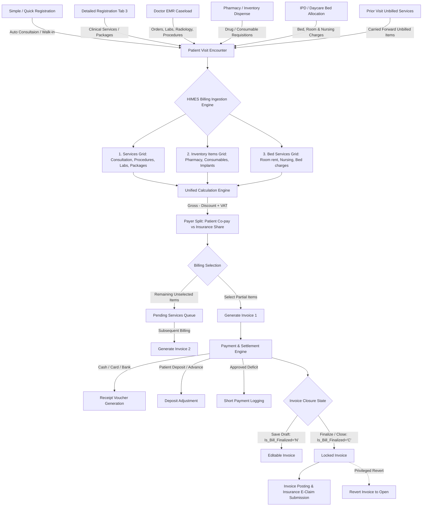
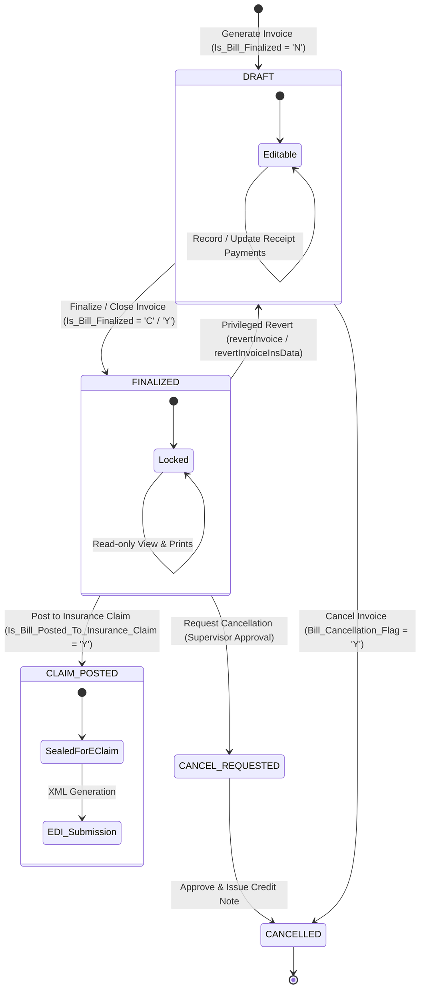

# HIMES Patient Billing Workflow: Senior Architect Specification

This document provides the definitive, comprehensive architectural specification of the **Patient Billing & Revenue Cycle Management System** in HIMES. It details all underlying master tables, calculation algorithms, controller methods, blade views, multi-invoice structures, and operational workflows.

---

## 1. Architectural Overview & System Entry Points

HIMES implements a dual-interface architecture for Patient Billing:

```
┌─────────────────────────────────────────────────────────────────────────────────┐
│                           HIMES BILLING ENTRY POINTS                            │
├───────────────────────────────────────┬─────────────────────────────────────────┤
│ 1. Standalone Billing Module          │ 2. Embedded Registration Billing Tab    │
│ URL: /patientBilling/{id?}            │ URL: /patientRegistration (Tab: Bill)   │
│ Controller: PatientBillingGetCont     │ Controller: RegistrationTabController   │
│ Views: resources/views/billing/       │ Views: resources/views/registration/    │
│        PatientBilling/                │        BillingTab/                      │
├───────────────────────────────────────┼─────────────────────────────────────────┤
│ • Full-screen dedicated cashier desk  │ • Embedded within patient check-in flow │
│ • Global patient lookup & search      │ • Direct handoff from visit creation    │
│ • Comprehensive multi-visit history   │ • Instant receipt upon consultation     │
│ • Advanced credit notes & refunds     │ • Fast walk-in collection               │
└───────────────────────────────────────┴─────────────────────────────────────────┘
```

### 1.1 Architectural Flow Diagram



---

## 2. The 3 Core Billing Item Pillars

All billable items in HIMES originate from distinct clinical and logistical domains and converge into the central Billing Engine:

```
┌────────────────────────────────────────────────────────────────────────┐
│                        3 CORE BILLING ITEM PILLARS                     │
├───────────────────┬──────────────────────┬─────────────────────────────┤
│ 1. Services Grid  │ 2. Inventory Items   │ 3. IPD Bed Management       │
│ Table:            │ Table:               │ Table:                      │
│ Patient_Visit_    │ Patient_Visit_Drug_  │ Patient_Visit_IPD_Bed_      │
│ Services          │ Item_Details &       │ Details                     │
│                   │ Patient_Visit_       │                             │
│                   │ Inventory_Billing    │                             │
├───────────────────┼──────────────────────┼─────────────────────────────┤
│ • Doctor Consults │ • Pharmacy Drugs     │ • Bed Allocation charges    │
│ • Lab Investigations│ • Surgical Consumables│ • Room rent & ICU surcharges│
│ • Radiology Tests │ • Implants & Kits    │ • Nursing & Facility care   │
│ • Procedures/OT   │ • Stock Location /   │ • Discharge day billing     │
│ • Health Packages │   Batch tracking     │ • Multi-bed transfers       │
└───────────────────┴──────────────────────┴─────────────────────────────┘
```

### 2.1 Services Grid (`Patient_Visit_Services`)
- **Sources**: Registration tab, EMR Doctor Orders (`EMRServiceAdd`), Quick Registration, Treatment Plans (`Patient_Visit_Treatment_Plan`), or Direct Service addition in Billing (`newServiceAddtoVisit`).
- **Junction Tracking**: When billed, linked to `Patient_Bill_Detail_Services_Packages_Resources_Drugs` via `Patient_Visit_Services_Serial_No`.
- **Status Flags**:
  - `Is_Service_Billed`: `'N'` (Pending) $\rightarrow$ `'Y'` (Billed).
  - `Is_Service_Fulfilled`: Clinical fulfillment marker (e.g., LIS sample collected `'SC'`, RIS report completed `'RC'`).
  - `Service_Secondary_Status`: `'E'` (Excluded), `'P'` (Pre-auth required), or `'C'` (Covered).
  - `Patient_Visit_Service_Cancellation_Flag`: `'Y'` indicates cancellation before billing.

### 2.2 Inventory Items Grid (`Patient_Visit_Drug_Item_Details` & `Patient_Visit_Inventory_Billing`)
- **Sources**: Pharmacy prescription dispensing, OT Consumables requisition, Ward consumable orders.
- **Stock Tracking**: Tracks `Stock_Location_Serial_No`, `Item_Master_Serial_No`, `Item_UOM_Serial_No`, `Batch_No`, and `Expiry_Date`.
- **Price Calculation**: Managed via `CreateItemPriceForInventoryBilling()` based on Cash Tariff or Insurance Formulary rates.
- **Returns & Reversals**: `returnstockfromcustomerQty()` reverses physical inventory and restores stock when lines are deleted or credited.

### 2.3 Bed Management Grid (`Patient_Visit_IPD_Bed_Details`)
- **Sources**: IPD / Daycare admission, Ward transfers, ICU occupancy.
- **Computation**: Loaded via `PatientBillingPartOneController@getBillingBedManagementGrid`. Calculates hourly or daily bed rent, nursing fees, and doctor rounds.

---

## 3. Multi-Invoice Architecture per Visit

A cornerstone of the HIMES billing engine is its **one-to-many Visit-to-Invoice architecture**:

```
                         ┌───────────────────────────────────┐
                         │ Patient Visit: PVBD-100245        │
                         │ Total Items: 10                   │
                         └─────────────────┬─────────────────┘
                                           │
                  ┌────────────────────────┴────────────────────────┐
                  ▼                                                 ▼
       Selected Items (3 Items)                         Unselected Items (7 Items)
  ┌─────────────────────────────────┐               ┌─────────────────────────────────┐
  │ Invoice #1: INV-00891           │               │ Status: Pending Billing Queue   │
  │ • Doctor Consultation           │               │ • Blood Panel (Lab)             │
  │ • Fast ECG                      │               │ • Chest X-Ray (Radiology)       │
  │ • Emergency Nursing             │               │ • 5 Pharmacy Medications        │
  │ Status: Finalized / Billed      │               └────────────────┬────────────────┘
  └─────────────────────────────────┘                                │
                                                    ┌────────────────┴────────────────┐
                                                    ▼                                 ▼
                                          Add to Invoice #1 (if Open)    Generate New Invoice #2
                                          or Generate Invoice #2         │ Invoice #2: INV-00892  │
                                                                         │ • 2 Lab/Rad Services   │
                                                                         │ • 5 Pharmacy Items     │
                                                                         └────────────────────────┘
```

### 3.1 Global View Dual-Row Representation
In the Global Billing Monitor (`viewGlobalPatientBilling` / `GlobalViewPatientBillingController.php`):
1. **Row 1 (Billed Invoice)**: Displays `Permanent_Invoice_No`, gross amount, payment received, settlement status (`Billed`, `Finalised`, `Partially Paid`).
2. **Row 2 (Pending Invoice)**: If the encounter has unbilled services (`Is_Service_Billed = 'N'`), a dedicated **"Pending"** row is generated for that visit.
3. **Action Pathways**:
   - The cashier can open the existing open invoice to append services.
   - Or click the **Pending** row to spin up a completely independent second invoice (`Patient_Bill_Header`) for the same visit.

### 3.2 Unbilled Services Carry-Forward from Prior Visits
- Method: `PatientBillingPartOneController@getInvoicePendingServices`
- Looks up `PVS.Patient_Previous_Visit_Basic_Details_Serial_No`. If an unbilled service from a past visit was transferred to the current encounter, it is retrieved and rendered with a badge `Target_Visit_No`, allowing the clinic to collect overdue service fees without altering historical closed books.

---

## 4. Invoice State Machine & Lifecycle Transitions



### 4.1 State Definitions & Locking Rules

| State | DB Indicators | System Behavior & Permissions |
| :--- | :--- | :--- |
| **Draft / Open** | `Is_Bill_Finalized = 'N'`<br>`Bill_Cancellation_Flag = 'N'` | **Fully Editable**: Services, inventory, and bed items can be added, updated, or deleted. Prices, discounts, and co-pays recalculate dynamically. Payments can be received. |
| **Finalized / Closed** | `Is_Bill_Finalized = 'C'` or `'Y'`<br>`Closed_By_User_Id != NULL` | **Locked Against Edits**: Financial and service lines are frozen. Standard users cannot edit row data. Printable as official Tax / Credit / Cash invoice. |
| **Privileged Revert** | Reset to `Is_Bill_Finalized = 'N'` | **Re-opened**: Allowed only if user holds the `isRevertInvoice` and `Revert` ACL permissions, no active credit note exists (`Credit_Note_Flag = 'N'`), and the invoice has not yet been posted to claims. |
| **Claim Posted** | `Is_Bill_Posted_To_Insurance_Claim = 'Y'` | **Permanently Sealed**: Invoice is bound into the monthly insurance remittance batch. Frontend reversion and deletion are strictly disabled (`Generate_Invoice_After_Claim_Post = 'N'`). |
| **Cancelled / Refunded** | `Bill_Cancellation_Flag = 'Y'` | **Voided**: Requires `cancelInvoiceUpdate()`. Reverses patient receivables, voids receipts, restores inventory stock, and logs audit trail. |

---

## 5. Master Tables Inventory

```
┌────────────────────────────────────────────────────────────────────────┐
│                        MASTER TABLES INVENTORY                         │
├───────────────────┬────────────────────────────────────────────────────┤
│ Domain            │ Tables & Primary Keys                              │
├───────────────────┼────────────────────────────────────────────────────┤
│ Invoice Headers   │ Patient_Bill_Header, Bill_Counter, Bill_Counter_   │
│                   │ User, Branch_Wise_Invoice_Generation               │
├───────────────────┼────────────────────────────────────────────────────┤
│ Invoice Items     │ Patient_Bill_Detail_Services_Packages_Resources_   │
│                   │ Drugs, Patient_Visit_Services, Patient_Visit_      │
│                   │ Drug_Item_Details, Patient_Visit_Inventory_Billing │
├───────────────────┼────────────────────────────────────────────────────┤
│ Payments & Settl. │ Patient_Bill_Header_Payments_Received, Receipts_   │
│                   │ For_Payments_Received, Patient_Visit_Deposits_     │
│                   │ Adjusted_Bills, Patient_Deposit_Log                │
├───────────────────┼────────────────────────────────────────────────────┤
│ Discounts & Auth  │ Patient_Visit_Discount_Log, Discount_Reason,       │
│                   │ User_Wise_Discount_Limit, Short_Payment_Reason     │
├───────────────────┼────────────────────────────────────────────────────┤
│ Insurance Co-pay  │ Insurance_Plans, Insurance_Plan_Department_Cover,  │
│                   │ Patient_Visit_Insurance_Service_Cover_Details      │
├───────────────────┼────────────────────────────────────────────────────┤
│ Tax & VAT         │ Universal_Code_Values (Tax Category), Service_     │
│                   │ USSDB, Installation_Parameters                     │
├───────────────────┼────────────────────────────────────────────────────┤
│ Credit & Refunds  │ Patient_Visit_Credit_Notes, Credit_Notes,          │
│                   │ Invoice_Cancel_Request, Patient_Refund_Details     │
├───────────────────┼────────────────────────────────────────────────────┤
│ UI Customization  │ List_Based_Column_Swapping, User_Based_Column_     │
│                   │ Swapping, User_Billing_Column_Order                │
└───────────────────┴────────────────────────────────────────────────────┘
```

---

## 6. Calculation Engine: Tariff, Discounts, Co-Pay & VAT

The calculation pipeline executes systematically on every line item and rolls up to the invoice header:

```
┌─────────────────────────────────────────────────────────────────────────────┐
│                          CALCULATION FLOW PER LINE                          │
│                                                                             │
│   Unit Price  x  Quantity  =  Gross Amount                                  │
│                                                                             │
│   Gross Amount  -  Row Discount Amount  =  Discounted Base                  │
│                                                                             │
│   Discounted Base  -  Additional Invoice Discount Share  =  Net Amount      │
│                                                                             │
│                        Net Amount Split                                     │
│                       ┌────────────────┴───────────────┐                    │
│                       ▼                                ▼                    │
│             Patient Share (Co-pay)             Insurance Share              │
│                       │                                │                    │
│                 + Patient VAT                    + Insurance VAT            │
│                       │                                │                    │
│                       ▼                                ▼                    │
│               Total Patient Due               Total Insurance Claim         │
└─────────────────────────────────────────────────────────────────────────────┘
```

### 6.1 Step-by-Step Mathematical Formulation

#### 1. Gross Amount Calculation
$$\text{Gross Amount} = \text{Unit Price} \times \text{Quantity}$$

#### 2. Row-Level Discount
- Can be entered as a percentage ($D\%$) or fixed amount ($D_{\text{amt}}$):
$$\text{Row Discount Amount} = \text{Gross Amount} \times \left(\frac{D\%}{100}\right)$$
$$\text{Net Before Additional Discount} = \text{Gross Amount} - \text{Row Discount Amount}$$
- **Validation**: Enforced against `User_Wise_Discount_Limit` (`Minimum_Discount_Percentage` to `Maximum_Discount_Percentage`). If discount exceeds limit or requires authorization, a `discountCodeModal` prompt requires a supervisor approval code.

#### 3. Additional (Invoice-Level) Discount
- Applied globally across the entire invoice and pro-rated across eligible lines:
$$\text{Line Additional Discount} = \frac{\text{Line Net Before Additional Discount}}{\sum \text{Eligible Lines Net}} \times \text{Total Additional Discount}$$
$$\text{Final Line Net Amount} = \text{Net Before Additional Discount} - \text{Line Additional Discount}$$

#### 4. Co-Pay & Deductible Split
- Derived from `Insurance_Plan_Department_Cover` and visit-level overrides:
  - **Co-Pay Percentage ($CP\%$)**: e.g., 20% patient share.
  - **Deductible Cap ($D_{\text{cap}}$)**: Maximum patient co-pay per visit or encounter (e.g., AED 50.00 max).
  - **Pre-Auth Limit**: If prior authorization is approved for an exact amount, insurance covers up to the approved limit; excess shifts to patient share.
$$\text{Calculated Patient Share} = \min\left(\text{Final Line Net Amount} \times \frac{CP\%}{100},\; D_{\text{cap}}\right)$$
$$\text{Insurance Share} = \text{Final Line Net Amount} - \text{Calculated Patient Share}$$

#### 5. VAT / Tax Engine (Patient vs Insurance Split)
- Configured via `Service_USSDB` and master tax parameters (e.g., 5% UAE VAT, 15% KSA VAT):
$$\text{Tax Rate} = T\%$$
$$\text{Patient Tax} = \text{Calculated Patient Share} \times \left(\frac{T\%}{100}\right)$$
$$\text{Insurance Tax} = \text{Insurance Share} \times \left(\frac{T\%}{100}\right)$$
$$\text{Total Line Tax} = \text{Patient Tax} + \text{Insurance Tax}$$

#### 6. Final Header Totals
$$\text{Total Patient Payable} = \sum (\text{Calculated Patient Share} + \text{Patient Tax})$$
$$\text{Total Insurance Claim} = \sum (\text{Insurance Share} + \text{Insurance Tax})$$

---

## 7. Payment Settlement, Deposits & Short Payments

### 7.1 Multi-Mode Payment Collection
Patient Share is collected via one or more simultaneous payment modes:
- **Cash**: Direct cash drawer collection.
- **Card (Credit / Debit)**: Logs Card Type, Authorization / Approval Code, Last 4 digits, Card Machine Terminal.
- **Bank Transfer / Cheque**: Logs Bank Name, Cheque / Ref Number, Clear Date.
- **Online / Voucher**: Integrated payment gateway transaction ID.

### 7.2 Patient Deposit / Advance Adjustment
- Patients often hold advance deposits in `Patient_Deposit_Log`.
- In billing, the cashier can click **"Utilize Deposit"** (`reloadDeposit` / `Patient_Visit_Deposits_Adjusted_Bills`).
- System supports **Split Settlement**: Part of the co-pay is deducted from existing deposit balance, and the remaining portion is collected via Cash/Card.

### 7.3 Short Payment Handling
- If a patient cannot pay the full patient share at checkout, and the branch configuration allows (`Allow_Short_Payment_In_Billing = 'Y'`):
  - Outstanding balance is logged in `Patient_Bill_Header.Short_Payment_Value`.
  - A mandatory reason code (`short_discountCodeModal`) and explanation remark are logged.
  - The invoice can still be finalized; the deficit becomes an outstanding account receivable tracked in `viewGlobalOutstandBilling`.

---

## 8. Invoice Modification, Refunds & Credit Notes

### 8.1 Post-Modification Excess Collection (Refund Prompt)
- When an open invoice is edited and a service is removed or discounted, the recalculated patient share may become **less than the amount already received**:
$$\Delta = \text{Total Previously Received} - \text{New Recalculated Patient Share}$$
- If $\Delta > 0$, the system automatically opens the **Refund / Excess Payment Dialog** (`refundamt`).
- The excess amount can be:
  1. Refunded directly to the patient via Cash (`Patient_Refund_Details`).
  2. Credited back to the patient's internal deposit account / wallet balance for future visits.

### 8.2 Credit Notes (`Patient_Visit_Credit_Notes` & `Credit_Notes`)
- Used for finalized/closed invoices when services are cancelled post-closure.
- Method: `AddCreditNote()` $\rightarrow$ Generates an official Credit Note document with sequential numbering, reversing ledger receivables and crediting customer account.

### 8.3 Invoice Cancellation Workflow
- Governed by `InvoiceCancelRequestController.php` and `cancelInvoiceUpdate`:
  1. Cashier submits an **Invoice Cancel Request** detailing the reason.
  2. A supervisor reviews the request in `InvoiceWaitingListDetails.blade.php` and approves or rejects.
  3. Upon approval:
     - `Bill_Cancellation_Flag` set to `'Y'`.
     - Attached receipts are voided.
     - Any dispensed inventory items are restored to stock via `returnallstockfromcustomerQtyforcancelrequest()`.

---

## 9. Reports, Forms & Document Engine

HIMES incorporates a flexible reporting engine generating specialized invoice formats per regulatory and facility requirements:

| Document Type | Method / Blade View | Key Function |
| :--- | :--- | :--- |
| **Tax Invoice** | `printPatientTaxInvoiceDetail.blade.php`<br>`PatientBillingGetController@printPatientInvoicePdf` | Official FTA / ZATCA compliant tax invoice displaying TRN / VAT numbers, tax breakdown per item, patient vs insurance tax, and QR code. |
| **Credit Invoice** | `printPatientCreditInvoiceDetail.blade.php` | Issued for Insurance & Corporate visits. Sent to payers/TPAs showing negotiated gross, copay deductions, and net claimable amount. |
| **Cash Invoice** | `printPatientInvoiceDetail.blade.php` | Outpatient cash receipt for self-pay patients showing full price and cash discounts. |
| **Receipt Voucher** | `printReceiptPdf.blade.php`<br>`PatientBillingGetController@printReceiptPdf` | Dedicated financial voucher for every cash/card transaction with receipt serial number and cashier signature block. |
| **Proforma Invoice** | `printProformaInvoiceDetail.blade.php`<br>`printPatientProformaInvoicePdf` | Quotation and estimated cost sheet generated prior to procedures or admissions. Does not impact accounting ledgers. |
| **Insurance Claim Form** | `getInsuranceClaimFormList` | Official claim submission document matching standard CMS-1500 / DHA / HAAD / Daman claim formats. |

---

## 10. Dynamic UI Customization & Grid Column Swapping

HIMES empowers users and branches to configure their optimal table view through the **Column Swapping Engine**:

### 10.1 Mechanism
- Handled by `ShowBillingColumnList()` and `addBillHeaderColumnWiseUser()`.
- Reads column definitions from `List_Based_Column_Swapping` where `Function_Id = 'billhd'`.
- Columns are ordered by draggable status (`Column_Is_Draggable`) and fixed attributes (`Is_Fixed`).
- User-specific column order and visibility are saved in `User_Based_Column_Swapping` per `User_Id`.
- Cashiers can drag and drop columns (e.g., move *Prior Auth ID*, *Co-Pay %*, or *Discount Code* into immediate focus) and click **"Save Sequence"** to persist their customized grid.

---

## 11. Complete Privilege & Security ACL Matrix

All high-impact billing operations are protected by role-based function privileges configured in `config/functions.php`:

| Privilege Key | Config Identifier | Controlled Operational Capability |
| :--- | :--- | :--- |
| **Add Invoice** | `functions.billhd.id . '_add'` | Authorizes creation and generation of new invoices. |
| **Edit / Update** | `functions.billhd.id . '_edit'` | Authorizes editing existing unfinalized invoices. |
| **Generate & Close** | `functions.billhd.id . '_GENERATE CLOSE'` | Enables one-click invoice generation with immediate finalization/lockout. |
| **Unit Price Edit** | `functions.billhd.id . '_Unitprice'` | Allows manual override of default master service prices. |
| **Quantity Edit** | `functions.billhd.id . '_Quantity'` | Allows modifying service and drug quantities. |
| **FOC Toggle** | `functions.billhd.id . '_Foc'` | Authorizes marking services as Free of Charge (100% waiver). |
| **Row Discount %** | `functions.billhd.id . '_Discountpercentage'` | Unlocks editing row-level discount percentage input. |
| **Row Discount Amt**| `functions.billhd.id . '_Discountamount'` | Unlocks editing row-level discount fixed amount input. |
| **Addl Discount** | `functions.billhd.id . '_Additionaldiscount'` | Authorizes invoice-level global additional discount. |
| **Patient Share Override** | `functions.billhd.id . '_Patientshare'` | Permits manual alteration of calculated co-pay amount. |
| **Short Payment** | `functions.billhd.id . '_shortamt'` | Permits checking out patients with an uncollected balance. |
| **Utilize Deposit**| `functions.billhd.id . '_UtilizeDeposit'` | Authorizes drawing funds from patient advance deposit ledger. |
| **Revert Invoice** | `functions.billhd.id . '_REVERT'` | Authorizes reopening a finalized/closed invoice. |
| **Cancel Invoice** | `functions.billhd.id . '_CancelInv'` | Authorizes initiating or approving invoice cancellation. |
| **Package Delete** | `functions.billhd.id . '_PackageDelete'` | Authorizes removing package components from visit. |
| **Send SMS** | `functions.billhd.id . '_SendSMS'` | Authorizes triggering invoice summary SMS to patient mobile. |
| **Proforma Print** | `functions.proformainvoice.id . '_view'` | Enables generating and printing Proforma quotations. |
