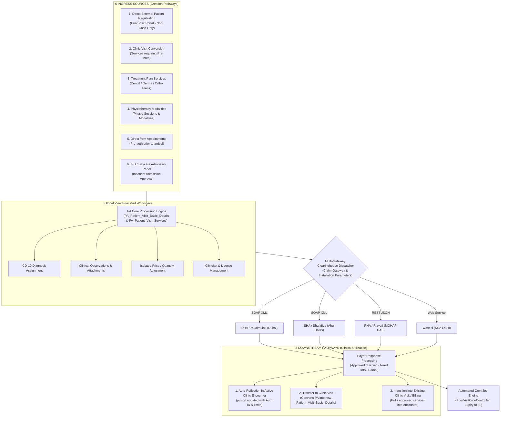
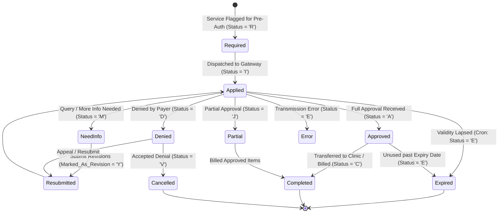

# HIMES Prior Visit & Prior Authorization Workflow: Senior Architect Specification

This document provides the definitive architectural specification of the **Prior Visit (Prior Authorization / Pre-Approval)** subsystem in HIMES. It details the underlying master and transactional tables, the 6 ingress pathways, multi-gateway clearinghouse submission mechanics, status state machines, cron automation, and bidirectional synchronization with clinic encounters.

---

## 1. Architectural Overview & Purpose

The **Prior Visit** module is a dedicated, specialized subsystem designed to isolate, manage, and process insurance prior authorization lifecycles prior to or in parallel with clinical delivery:

```
┌─────────────────────────────────────────────────────────────────────────────────┐
│                        PRIOR VISIT CORE SUBSYSTEM                               │
├───────────────────────────────────────┬─────────────────────────────────────────┤
│ Dedicated Ingress Portal              │ Global Management Workspace             │
│ URL: /viewPriorVisit/{id?}            │ URL: /globalViewForPriorVisitNew        │
│ Controller: PriorVisitController      │ Controller: GlobalViewPriorVisitNewCont │
│ View: resources/views/priorVisit/     │ View: resources/views/priorVisit/       │
│       registration.blade.php          │       globalView/mainNew.blade.php      │
├───────────────────────────────────────┼─────────────────────────────────────────┤
│ • Registers external pre-auth patients│ • Centralized monitoring for Approvals  │
│ • Strictly Non-Cash payment modalities│ • Multi-gateway submission dispatcher   │
│ • Captures initial clinical orders    │ • Observation, ICD-10 & file management │
│ • Mirrors clinic insurance plan rules │ • Resubmission & denial code management │
└───────────────────────────────────────┴─────────────────────────────────────────┘
```

### 1.1 Architectural Flow: 6 Ingress Channels to 3 Downstream Pathways



---

## 2. The 6 Ingress / Creation Workflows

HIMES supports 6 distinct entry points to generate a Prior Visit:

```
┌────────────────────────────────────────────────────────────────────────┐
│                        6 PRIOR VISIT ENTRY POINTS                      │
├───────────────────┬──────────────────────┬─────────────────────────────┤
│ Ingress Source    │ Controller & Method  │ Linkage Reference           │
├───────────────────┼──────────────────────┼─────────────────────────────┤
│ 1. Direct Ext. Reg│ PriorVisitController │ Standalone PA Record        │
│                   │ @postPriorVisitDetail│ (No Clinic PVBD Link)       │
├───────────────────┼──────────────────────┼─────────────────────────────┤
│ 2. Clinic Visit   │ PriorVisitController │ PA_Patient_Visit_Basic_Det  │
│    Conversion     │ @addServiceToPAVisit │ .Patient_Visit_Basic_Det_SNo│
├───────────────────┼──────────────────────┼─────────────────────────────┤
│ 3. Treatment Plan │ PriorVisitController │ Patient_Treatment_Plan      │
│    Services       │ @AddTreatmentPlanToPA│ .Patient_Treatment_Plan_SNo │
├───────────────────┼──────────────────────┼─────────────────────────────┤
│ 4. Physiotherapy  │ PriorVisitController │ Physio_Order_Details_       │
│    Modalities     │ @addServiceToPAVisit │ Services.PA_Patient_Visit_  │
│                   │                      │ Services_Serial_No          │
├───────────────────┼──────────────────────┼─────────────────────────────┤
│ 5. Appointments   │ PriorVisitController │ Patient_Appointment         │
│                   │ @AddTreatmentPlanToPA│ .Patient_Appointment_SNo    │
├───────────────────┼──────────────────────┼─────────────────────────────┤
│ 6. IPD Admission  │ PriorVisitController │ Patient_Visit_Admission_    │
│    Panel          │ @checkExistHAVisit   │ Details_Serial_No           │
└───────────────────┴──────────────────────┴─────────────────────────────┘
```

### 2.1 Direct External Patient Registration (`/viewPriorVisit`)
- **Primary Controller**: `app/Http/Controllers/priorVisit/PriorVisitOperationController.php` & `PriorVisitController.php`
- **Views**: `resources/views/priorVisit/registration.blade.php`, `demographics.blade.php`, `insuranceNew.blade.php`.
- **Core Behavioral Rules**:
  - Used when an external clinic or patient requests pre-approval before booking an appointment or arriving on site.
  - **Strict Payment Modality Restriction**: Non-Cash payment types ONLY! Cash is strictly excluded because prior authorization is solely applicable to Insurance, TPA, or Corporate payers.
  - Captures Demographics, Emirates ID (XML reader support), Insurance Company, TPA, Plan, Network, and Card details.
  - Generates standalone `PA_Patient_Basic_Details` and `PA_Patient_Visit_Basic_Details`. The clinic encounter link `Patient_Visit_Basic_Details_Serial_No` remains `NULL`.

### 2.2 Clinic Encounter Conversion (Clinic Visit $\rightarrow$ Prior Visit)
- **Trigger**: Occurs in Detailed Registration or Doctor EMR Caseload when ordered services have `Prior_Approval_Required_Flag = 'Y'`, exceed department pre-auth thresholds, or are flagged in `Insurance_Plan_Excluded_Prior_Approval_Services`.
- **Linkage**:
  - Sets `PA_Patient_Visit_Basic_Details.Patient_Visit_Basic_Details_Serial_No = pvbd.Patient_Visit_Basic_Details_Serial_No`.
  - Sets `PA_Patient_Visit_Services.Patient_Visit_Services_Serial_No = pvs.Patient_Visit_Services_Serial_No`.
  - Clinical encounter is explicitly referenced so that when approval arrives, the clinical visit is immediately updated.

### 2.3 Treatment Plan Services (`AddTreatmentPlanToPriorVisit`)
- **Context**: Dental charting, Orthodontic workflows, or Derma treatment packages where procedures are planned across multiple weeks/months.
- **Workflow**:
  - User opens Treatment Plan panel (`Patient_Treatment_Plan`), selects specific planned procedures (including `Alternate_Teeth_Name` and `Dental_Teeth_Surface`), and clicks **Send to Prior Visit**.
  - `AddTreatmentPlanToPriorVisit` copies the services into `PA_Patient_Visit_Services` and stamps `Patient_Treatment_Plan.Is_Service_Sent_To_PA_Visit = 'Y'`.
  - Creates an independent PA visit referenced to the treatment plan.

### 2.4 Physiotherapy Modalities (`Physio_Order_Details_Services`)
- **Context**: Rehabilitation medicine where physicians prescribe 6 to 12 sessions of physical therapy modalities (e.g., Ultrasound, TENS, Traction, Hydrotherapy).
- **Workflow**:
  - Prescriptions in the Physiotherapy module track `Total_No_Of_Sessions` and `Total_No_Of_Sessions_Remaining`.
  - Services are bundled with primary ICD-10 codes and pushed to Prior Visit.
  - Linkage is maintained via `Physio_Order_Details_Services.PA_Patient_Visit_Services_Serial_No`.

### 2.5 Direct Appointment Conversion
- **Context**: Front desk books a future appointment for an MRI, CT scan, or specialized surgery.
- **Workflow**:
  - The appointment record (`Patient_Appointment`) stores the planned `Service_USSDB_Serial_No` and `Resource_Serial_No`.
  - Cashier triggers pre-authorization directly from the Appointment Scheduler (`pageFrom = 'AP'`).
  - Enables obtaining insurance approval before the patient presents for registration.

### 2.6 IPD / Daycare Admission Panel Conversion
- **Context**: Elective surgeries, planned inpatient stays, or daycare procedures requiring advance admission approval from payers.
- **Workflow**:
  - The Inpatient Admission Details panel contains a **"Convert to Prior Visit"** action (`priorToExistingHAModel.blade.php`).
  - Carries forward admission type, estimated length of stay (LOS), room type, and primary surgical procedure into Prior Visit.

---

## 3. Dedicated PA Database Architecture

The Prior Visit subsystem maintains parallel mirror tables prefixed with `PA_`, ensuring pre-approval operations do not mutate active financial or clinical records:

```
┌────────────────────────────────────────────────────────────────────────┐
│                        PARALLEL SCHEMA MAPPING                         │
├───────────────────────────────────┬────────────────────────────────────┤
│ Clinical Encounter Schema (Clinic)│ Prior Visit Subsystem Schema (PA)  │
├───────────────────────────────────┼────────────────────────────────────┤
│ Patient_Basic_Details             │ PA_Patient_Basic_Details           │
│ Patient_Visit_Basic_Details       │ PA_Patient_Visit_Basic_Details     │
│ Patient_Visit_Services            │ PA_Patient_Visit_Services          │
│ Patient_Visit_Resources           │ PA_Patient_Visit_Resources         │
│ Patient_Visit_Insurance_Card_Det  │ PA_Patient_Visit_Insurance_Card_Det│
│ Patient_Visit_Insurance_Service_  │ PA_Patient_Visit_Insurance_Service_│
│   Cover_Details                   │   Cover_Details                    │
│ Patient_Visit_Diagnosis           │ PA_Patient_Visit_Diagnosis         │
│ Patient_Visit_Observations        │ PA_Patient_Visit_Observations      │
│ Patient_Visit_Logs                │ PA_Prior_Approval_Log              │
└───────────────────────────────────┴────────────────────────────────────┘
```

### 3.1 Key Foreign Key References & Cross-Pointers
- `PA_Patient_Visit_Basic_Details.Patient_Visit_Basic_Details_Serial_No`: Nullable foreign key pointing to the live clinic visit (populated if converted from clinic, `NULL` if direct external).
- `PA_Patient_Visit_Services.Patient_Visit_Services_Serial_No`: Links specific PA service lines to clinic service lines.
- `PA_Patient_Visit_Services.Patient_Treatment_Plan_Serial_No`: Links PA service line to Treatment Plan.
- `Physio_Order_Details_Services.PA_Patient_Visit_Services_Serial_No`: Links physiotherapy modality tracking to PA service line.

---

## 4. Workspace Customization & Clinical Preparation

Within the Global Workspace (`GlobalViewPriorVisitNewController.php` / `resources/views/priorVisit/globalView/mainNew.blade.php`), coordinators enrich the submission payload:

### 4.1 Diagnosis Management (ICD-10)
- Endpoints: `PAaddICDtoVisitPrior`, `PADeleteDiagnosisPrior`, `PAupdateDiagnosisSortOrder`.
- Primary vs Secondary Diagnosis: System enforces exactly one Primary ICD-10 (`Diagnosis_Type = 'P'`) and multiple secondary diagnoses (`'S'`).
- Clinicians can import diagnoses directly from Doctor EMR records (`addICDFromHimesVisitSummaryService`).

### 4.2 Clinical Observations & Supporting Evidence
- Endpoints: `PAaddObservation`, `PAviewObservation`, `PAdeleteObservation`, `PAdownloadObservationZipFile`.
- Encodes clinical parameters mandated by payers:
  - Observation Types: Vital Signs (BP, Pulse, Temperature), Lab Results, Clinical Findings, Symptom Duration.
  - File Attachments: Medical report PDFs, clinical photographs, X-Ray images, and lab sheets are bundled and compressed into zip archives for gateway upload.

### 4.3 Isolated Price & Quantity Adjustments
- Endpoints: `PAupdateServiceQuntyGrid`, `PAupdatePatientSharePrior`.
- **Architectural Isolation Principle**:
  - The insurance coordinator can adjust the submitted `Service_Rate`, `Quantity`, or `Patient_Share_Amount` specifically for the pre-authorization claim.
  - **These modifications update ONLY `PA_Patient_Visit_Insurance_Service_Cover_Details` and `PA_Patient_Visit_Services`**.
  - The master clinic tariff and live visit billing records remain completely unaltered, preventing financial drift in hospital accounting.

### 4.4 Clinician & License Overrides
- Endpoint: `updateClinicianAndReferalClinicianDetails`.
- Allows modifying the Ordering Clinician License Number or Referral Clinician License Number specifically for the submission payload without changing the attending doctor assigned to the patient's hospital visit.

---

## 5. Multi-Gateway Clearinghouse Submission Engine

HIMES incorporates an adaptive multi-gateway submission pipeline (`getAuthorization()`):

```
┌─────────────────────────────────────────────────────────────────────────────┐
│                      SUBMISSION GATEWAY DISPATCHER                          │
├───────────────────┬──────────────┬──────────────────┬───────────────────────┤
│ Gateway System    │ Region       │ Payload Format   │ Protocol / Transport  │
├───────────────────┼──────────────┼──────────────────┼───────────────────────┤
│ DHA (eClaimLink)  │ Dubai, UAE   │ SOAP 1.1/1.2 XML │ HTTP POST / ASMX      │
│ SHA (Shafafiya)   │ Abu Dhabi    │ SOAP XML         │ HTTPS / Web Services  │
│ RHA (Riayati)     │ MOHAP (UAE)  │ REST JSON        │ HTTPS Bearer Token API│
│ Waseel            │ KSA (CCHI)   │ Web Service XML  │ HTTPS SOAP WSDL       │
└───────────────────┴──────────────┴──────────────────┴───────────────────────┘
```

### 5.1 Gateway Resolution Hierarchy
1. **Visit-Level Override (`Claim_Gateway`)**: The coordinator can override the payer gateway at the individual visit level via `getInsuranceMethodAndUrlForVisit($Visit)`.
2. **Master Default**: If no visit override is set, the system falls back to `Installation_Parameters.Insurance_Method` and `Insurance_Claim_URL`.

### 5.2 Payload Construction & Formatting
- **DHA / SHA (XML Payload)**:
  - Formats clinical data into standard XML schema (`<PriorAuthorization.Request>`).
  - Injects Provider License, Clinician License, Card details, Diagnosis elements (`<Diagnosis>`), Activity items (`<Activity>`), and Observation tags (`<Observation>`).
  - Wraps in SOAP envelope with header action `http://www.eClaimLink.ae/UploadTransaction`.
- **RHA (Riayati JSON Payload)**:
  - Converts data elements into structured JSON objects matching Riayati Authorization REST endpoints (`/api/Authorization/PostRequest`).
  - Headers set to `application/json` with Bearer token authentication.

### 5.3 Initial Transmission & Status Transition
- When the coordinator clicks **"Send Request"**:
  1. Payload is transmitted via cURL.
  2. Gateway returns immediate transmission receipt / acknowledgment.
  3. If accepted, status transitions from **Required / Pending (`'R'`)** $\rightarrow$ **Applied / In-Progress (`'I'`)**.
  4. If transmission fails, status remains `'R'`, and the error is logged to `PA_Prior_Approval_Log`.

---

## 6. Approval Lifecycle, Status Machine & Cron Automation



### 6.1 Status Codes Reference (`Prior_Status`)

| Code | Status Name | Operational Meaning |
| :---: | :--- | :--- |
| **`R`** | **Required** | Pre-auth required; not yet transmitted to payer gateway. |
| **`I`** | **Applied / In-Progress** | Transmitted to clearinghouse; awaiting adjudication. |
| **`A`** | **Approved** | Payer approved full requested quantity and price. Pre-Auth ID issued. |
| **`J`** | **Partially Approved** | Payer approved partial quantity or reduced tariff. Remaining marked rejected. |
| **`D`** | **Denied / Rejected** | Payer rejected authorization. Associated with specific `Denial_Code`. |
| **`M`** | **Need More Info** | Payer requests additional clinical justification, lab reports, or X-rays. |
| **`E`** | **Expired / Error** | Validity days lapsed without clinical utilization or unrecoverable error. |
| **`V`** | **Cancelled / Void** | Pre-auth request formally retracted or cancelled. |
| **`C`** | **Completed / Closed** | Pre-auth utilized in clinical visit and consumed by billing. |

### 6.2 Automated Expiry Cron Job (`PriorVisitCronController.php`)
- **Execution Endpoint**: `updatePriorApprovalStatus/{branch?}`
- **Automated Business Rules**:
  - Evaluates all active PA records where status is in `('D', 'M')` or pending:
    $$\text{Applied Date} + \text{Insurance Approval Validity Days} \le \text{Yesterday}$$
  - Automatically updates `PA_Patient_Visit_Insurance_Service_Cover_Details.Insurance_Prior_Approval_Status = 'E'` (Expired).
  - Logs audit trace via `PAauditLogService@logModification` under action `cron_expire`.
  - **Clinical Safety Fallback**: If the PA record is linked to an active unbilled clinic visit (`Patient_Visit_Services`), the system automatically runs:
    ```sql
    UPDATE Patient_Visit_Services 
    SET Patient_Payment_Type_Code = 'CASH' 
    WHERE Patient_Visit_Services_Serial_No = :pvsSno
    ```
    This prevents billing expired pre-authorizations to insurance, protecting the clinic against subsequent claim rejections.

---

## 7. Downstream Clinical Integration (3 Egress Channels)

Once prior approval is secured, HIMES provides 3 pathways to utilize the pre-authorization:

```
┌────────────────────────────────────────────────────────────────────────┐
│                     3 DOWNSTREAM UTILIZATION PATHWAYS                  │
├───────────────────┬──────────────────────┬─────────────────────────────┤
│ Utilization Mode  │ Controller & Method  │ Action & Result             │
├───────────────────┼──────────────────────┼─────────────────────────────┤
│ 1. Auto-Reflection│ GlobalViewPriorVisit │ Immediately updates active  │
│    in Clinic Visit│ Controller           │ visit PVISCD with Auth ID,  │
│                   │                      │ approved qty & share limits │
├───────────────────┼──────────────────────┼─────────────────────────────┤
│ 2. Transfer to    │ PriorVisitTransfer   │ Transforms standalone PA    │
│    Clinic Visit   │ Controller           │ into full Patient_Visit_    │
│                   │ @transferPriorVisit  │ Basic_Details encounter     │
├───────────────────┼──────────────────────┼─────────────────────────────┤
│ 3. Pull into Visit│ PriorVisitTransfer   │ Injects approved PA services│
│    or Billing     │ Controller           │ into selected ongoing clinic│
│                   │ @addProirVisitService│ visit or pending billing    │
└───────────────────┴──────────────────────┴─────────────────────────────┘
```

### 7.1 Automatic Reflection in Active Clinic Encounters
- When the Prior Visit was converted from an existing clinic encounter (`Patient_Visit_Basic_Details_Serial_No` is present):
  - Receipt of gateway approval instantly updates `Patient_Visit_Insurance_Service_Cover_Details`.
  - Stamps `Prior_Authorization_Id`, `Payment_Amount`, `Patient_Share_Amount`, `Insurance_Approved_Rejected_Date`, and `Insurance_Approval_Validity_Days`.
  - The Doctor EMR and Billing screens immediately reflect the approved status, enabling immediate clinical delivery and checkout.

### 7.2 Full Transfer to Clinic Encounter (`transferPriorVisitDetails`)
- When the patient was registered directly in the Prior Visit portal:
  - Clicking **"Transfer to Clinic"** invokes `transferPriorVisitDetails()`.
  - Automatically executes the following sequence within a DB transaction:
    1. `InsertPatientBasicDetails`: Creates or reconciles clinic MRN (`Permanent_MRN_No`).
    2. `InsertPatientBasicIdentificationDetails`: Migrates Emirates ID and cards.
    3. `InsertPatientVisitDetails`: Creates new `Patient_Visit_Basic_Details` with clinic token.
    4. `InsertPatientVisitServiceDetails`: Injects all approved service lines.
    5. `InsertPatientInsuranceCardDetails`: Sets up active insurance card.
    6. `InsertPatientVisitServiceCoveredDetails`: Freezes pre-auth ID and approved limits.
    7. `InsertPatientVisitICDDetails` & `InsertPatientVisitObservationDetails`: Copies diagnoses and observations.

### 7.3 Pulling Approved Services into Ongoing Visit or Billing
- **Encounter Service Pull (`addProirVisitServicetoHimesVisit`)**:
  - A patient with existing approved PA records arrives for an unrelated or follow-up visit.
  - The cashier opens the **"Import Approved PA Services"** dialog (`loadExistingHAVisit.blade.php`).
  - System verifies validity: Checks if `End_Date >= Current_Date`.
  - Selected approved services are appended into the active visit, copying authorization numbers.
- **Billing Queue Ingestion**:
  - In Standalone Billing or Registration Billing Tab, approved unbilled services appear in the **Pending Services** queue.
  - When billed, the `Prior_Authorization_Id` is stamped onto `Patient_Bill_Header` and claim lines, suppressing co-pay deduction errors.

---

## 8. Audit Logging, History & Resubmission Engine

### 8.1 Archival Audit Logging (`PA_Prior_Approval_Log`)
- Managed via `priorVisit\PriorVisitPriorApprovalLogController.php` and `PAauditLogService.php`.
- Every dispatch and inbound response preserves the **raw XML / JSON payload**:
  - Stores `Request_File_Path`, `Response_File_Path`, `Transaction_Date_Time`, `User_Id`, and `Status_Code`.
  - Available for compliance audit through `getPVPASubmissionHistoryDetails` and downloadable via `downloadPriorRequestResponseFile/{id}/{type}`.

### 8.2 Denial Management & Resubmission Workflow
- Endpoints: `getPriorResubmission`, `insertPAResubmission`, `deletePAResubmission`.
- When an authorization is Denied (`'D'`) or requires More Information (`'M'`):
  1. The coordinator reviews the attached payer `Denial_Code`.
  2. Updates clinical notes, corrects CPT/ICD coding, or attaches supplemental lab reports.
  3. Triggers **Resubmission**: Clones record with `Marked_As_Revision = 'Y'`, references original authorization reference, and re-submits to gateway.
